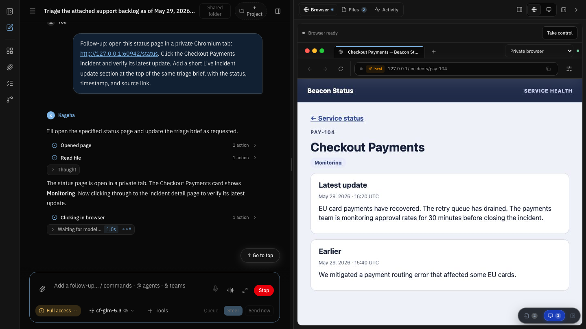

# Kageha

**Kageha is the Rust version of the personal AI assistant I’ve been using for several years.** It runs on your own machine or server and gives the assistant a workspace for files, a live browser, and a chat where you can follow its work and steer it.

[Watch the 48-second demo](https://github.com/veerupandey/kageha/releases) · [Quick start](#quick-start) · [Features](#features) · [Build from source](#build-from-source)

[](https://github.com/veerupandey/kageha/releases)

Open **Watch Kageha work (48-second MP4)** under the release assets. In the demo, Kageha turns a support backlog into a brief. A follow-up in the same conversation asks it to check an incident in Chromium, verify the latest update, and revise the original file.

## Features

| Capability | What you can do |
| --- | --- |
| **Chat and follow-ups** | Attach files, queue a follow-up or steer a running turn, and review tool activity, approvals, and results from the same conversation. |
| **Projects, files, and memory** | Keep chats and artifacts in project workspaces, preview and download results, and use saved knowledge and learned preferences across sessions. |
| **Live browser and research** | Run web research with citations, and watch Kageha navigate, inspect pages, fill forms, and move files in a private Chromium session. Take over from the Browser panel, or explicitly approve a connection to a configured Chrome or Comet session. |
| **Decision models** | Choose a separate model for bounded browser decisions. Kageha supports Clef, Jev, Luna Decisions, and Gemini Decision 1, and can fall back to the regular agent model when a decision route is unavailable or uncertain. |
| **Terminal and computer control** | Run commands in a workspace, attach an SSH-connected Linux machine, start a Docker workstation with a live desktop, or use the optional native macOS desktop helper. |
| **Planning and specialist agents** | Review a plan before execution, run goal-oriented workflows, and delegate work to agents and teams with their own instructions, skills, and tool policies. |
| **Scheduled work and recovery** | Schedule follow-ups and recurring checks. Review persisted job state, action receipts, and recovery progress when interrupted work resumes. |
| **Permissions and connectors** | Review sensitive actions before they run. Connect services such as GitHub, Gmail, and Google Calendar, and add capabilities through MCP, plugins, skills, and hooks. |
| **Models and media** | Bring your own provider credentials or a compatible local endpoint. The catalog includes OpenAI, Anthropic, Gemini, Cloudflare Workers AI, and Command Code. Configure image generation, including Gemini Nano Banana, and speech transcription or synthesis separately. |
| **Personal messaging** | Connect Telegram, or run a separate single-owner instance for WhatsApp and iMessage. Add Twilio for SMS and voice calls, and receive progress, approval requests, and files in supported channels. |
| **Developer interfaces** | Use the terminal UI or connect your own tools through HTTP, MCP, and the Rust, TypeScript, or Python SDKs. |

Optional providers, integrations, messaging channels, and execution targets each require their own setup.

## Quick start

Download and extract the archive for your platform from [GitHub Releases](https://github.com/veerupandey/kageha/releases). If an archive is unavailable, [build one from source](#build-from-source).

| Platform | Start and sign in |
| --- | --- |
| **macOS · Apple silicon** | Open **Start Kageha.command**. Once the server is listening, open **Sign in.command** and paste the copied token into the sign-in form. |
| **Linux · x64** | Run `./start` and open [127.0.0.1:8788](http://127.0.0.1:8788). Run `./start token` in a second terminal and paste the token into the sign-in form. |

In **Settings → Models**, connect a provider or a compatible local endpoint. Select a model, ask Kageha to create a short checklist, and open the result in **Files**.

The launcher stores chats and settings in `~/.kageha-local`. Use an absolute `KAGEHA_DATA_DIR` for a separate instance and `KAGEHA_WEBUI_PORT` to change the port. Use the same settings when retrieving the sign-in token. Press **Ctrl-C** to stop the launcher.

## Build from source

Install stable Rust with Cargo, Node.js 24 with npm, Git, and OpenSSL. From a checkout of this repository, run `scripts/package_release.sh`, extract the archive in `dist/`, and follow the [quick start](#quick-start).

For a development checkout, build and run the web app directly.

```sh
cargo build --locked --release -p kageha-loop
npm --prefix frontend ci
npm --prefix frontend run build
scripts/start_webui.sh start
```

The development server listens on [127.0.0.1:8788](http://127.0.0.1:8788) by default and writes its sign-in token to `.kageha/rust-webui/server.token`. Run `scripts/start_webui.sh stop` to stop it.

## Guides

- [Using Kageha](https://github.com/veerupandey/kageha/blob/main/docs/USAGE.md) covers chats, files, planning, and approvals.
- [Linux deployment](docs/LINUX_DEPLOYMENT.md) covers service setup, HTTPS, SSH, and Docker.
- [Browser setup](https://github.com/veerupandey/kageha/blob/main/docs/BROWSER.md) and [browser decisions](https://github.com/veerupandey/kageha/blob/main/crates/kageha-browser-decisions/README.md) cover browsing modes and typed model configuration.
- [Personal companion](https://github.com/veerupandey/kageha/blob/main/integrations/personal/README.md) covers WhatsApp, iMessage, SMS, and voice setup.
- [Agents and teams](https://github.com/veerupandey/kageha/blob/main/docs/AGENTS.md), [Rust architecture](https://github.com/veerupandey/kageha/blob/main/docs/ARCHITECTURE.md), and [SDKs](https://github.com/veerupandey/kageha/blob/main/sdk/README.md) cover configuration and integration.

Released under the [MIT License](LICENSE).
