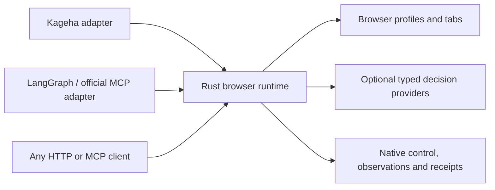

# Standalone browser service and agent integration

The browser binary owns browser connections, profiles, managed tabs, observations,
control grants, action receipts, scripts and preview frames. Kageha owns chats,
agent planning and UI presentation. Any framework can replace that host.
Browser execution remains Rust. The optional JavaScript client is a dependency-free
consumer of the HTTP API, with no browser automation implementation of its own.

## Framework-neutral decision contract

Kageha is one consumer of this runtime, alongside LangGraph or any other agent.
There is no Kageha chat database, agent loop, model catalog, UI or Python server
requirement. Framework-specific orchestration stays outside the browser service.



The runtime owns tab/profile identity, observation references, stale-state checks,
control leases, native input, receipts, scripts and previews. Frameworks own task
planning, conversational memory, facts supplied by the caller, user approval and
regular-LLM fallback. Thin adapters translate the same public contract; they do
not reimplement browser behavior. An optional preview client need not be Kageha's
right panel. Existing Kageha embedding uses the same portable Rust decision port;
configure one decision owner per deployment, rather than both host and daemon.

### Configure the daemon without Kageha

Put this operator-owned configuration in a private file (0600):

```json
{
  "version": 1,
  "decision": {"decision_model": "gpt-6-luna"},
  "contexts": [{
    "workspace": "my-workflow",
    "client": "langgraph-agent",
    "run": "task-001",
    "intent": "Fill the draft name from my supplied name. Do not save or submit.",
    "values": {"name": "Example Person"}
  }]
}
```

Pass `--decision-config /private/path/decisions.json` with either HTTP or MCP
startup. The model-name registry selects the typed endpoint and resolves provider
credentials from the daemon environment; no Kageha settings database is consulted.
Omitted `confidence_cutoff` defaults to **0.90 provider confidence**; omitted
`batch_confidence_cutoff` defaults to **0.99**. Jev, Clef/Clef-flash, GPT-6 Luna Decisions and Gemini Decision 1
use the same planner contract. A context may supply its own `decision` object to
override model/cutoff. Unspecified cutoffs inherit the host policy before defaults;
review policy and resource budgets are preserved. Explicit `models` entries remain
available for custom typed gateways and credential environment references.

For MCP, pin `--mcp-workspace my-workflow --mcp-client langgraph-agent` to that
context. Discover methods with `browser_info`, then use `browser_call` to invoke:

1. `browser_decision_info`: discover the current run ID, decision model, action
   mode, score metric and resolved cutoff. It returns no credentials or caller facts.
2. `observe_tab`: obtain the current observation from the owned browser.
3. `browser_decide` with `run_id`, `purpose: "browser_action"`, and `observation_id`.
4. Execute accepted proposals through the normal native methods and authority,
   mapping `value_id` back to the framework's caller-owned facts. No proposal itself
   dispatches input. When no actions are returned, use the regular agent route.
5. Inspect native receipts and fresh state; never automatically retry uncertain
   input or claim a whole task succeeded from a field receipt alone.

HTTP consumers use the same methods through the existing authenticated `/v1/rpc`
envelope. These are ordinary HTTP RPC endpoints, not MCP Streamable HTTP. The
JavaScript/Python SDKs are optional transports; a framework may use its own client.
MCP scope is launcher-fixed. HTTP is for one trusted tenant under the operator's
credential; workspace/client IDs are not independent tenant authentication.

Model-visible RPC arguments cannot replace the context's model, cutoff, intent,
values or approval policy. `trusted_click_targets` are not created by page flags
or a model probability; the daemon leaves fast-path navigation to the regular
executor. Context configuration is currently loaded at startup, not via a mutable
agent tool. Dynamic host context registration and durable daemon decision-budget
checkpointing remain separate work; do not treat this as a multi-tenant hosted
agent orchestrator. Input receipts already have their own native durability.

### Portability regression evidence

The standalone HTTP test configures decisions and verifies a 0.94 native confidence
is accepted at the default 0.90 cutoff even though selected probability is 0.80.
It rejects tool attempts to change the cutoff, and verifies proposals send no input.
That test exposed and fixed missing control projection in the daemon's cached
snapshot. Model workers now run outside an entered Tokio runtime, so standalone
HTTP/MCP model calls use the same transport contract as Kageha's embedded path.
Concurrent decision workers are bounded and retain cancellation/deadline controls.

`examples/langgraph-browser/tests/test_decision_portability.py` runs an actual
Python LangGraph agent through the official LangChain MCP adapter, with the native
Rust daemon and real disposable Chromium. It tests both the default-confidence
proposal and a stricter per-context cutoff that invokes the ordinary agent route.
Both inspect a verified native receipt and produce exactly one physical field
write, with no save or submission. The model providers are deterministic fixtures;
this proves integration behavior, not real-model planning accuracy.

```sh
KAGEHA_BROWSER_BIN=/absolute/path/kageha-browser \
  node crates/kageha-browser/tests/http_api.mjs
KAGEHA_BROWSER_BIN=/absolute/path/kageha-browser \
  uv run --directory examples/langgraph-browser pytest -q
```

The complete external LangGraph regression suite passed **32 tests**. It requires
no Kageha host and uses an empty daemon `PATH`. Only optional framework clients and
test fixtures use Python; the browser and decision execution remain Rust.

## Authorized account recovery and generated passwords

Configure `KAGEHA_BROWSER_CREDENTIAL_DIR` as an absolute, durable private directory
(0700), outside temporary daemon state. The Rust runtime generates a 192-bit random
password, encrypts it with XChaCha20-Poly1305 and writes it atomically before input.
The local key and encrypted records are private files (0600); protect and back up
this volume together. This file vault does not protect against compromise of the
runtime's operating-system account. It has no plaintext export API.

In an approved version-3 `run_script`, on the intended HTTPS account page:

```js
const saved = browser.credential('account@example.com');
browser.fillCredential('#new-password', saved.credential);
return browser.fillCredential('#confirm-password', saved.credential);
```

Only an opaque reference reaches the script/model. References are bound to the
workspace and exact HTTPS origin, including port. Calling `credential` again for
the same account reuses the stored password across turns and daemon restarts;
it never silently rotates an existing password. `fillCredential` accepts only
visible, enabled, writable password inputs in the main document. It uses fresh
observations, the existing control grant and durable verified input receipts.
Ordinary plaintext `fill` remains unable to fill password inputs. Frame-scoped
credential input, existing-password import/export and explicit password rotation
are not implemented by this API.

Snapshots containing password fields advertise `managed_credentials`, including
whether durable storage is configured and the script facade methods. The native
Rust Kageha host exposes these as `browser_credential` and
`browser_fill_credential`. Its adapter pins the approved backend-node/document
identity across the script's fresh observation instead of passing a stale e-ref.
The `backend=NODE@DOCUMENT` locator is accepted only for a node in the current
observation and exact document; it cannot authorize an unobserved node.

Account recovery is a host workflow: inspect current sign-in state, read authorized
recovery email, validate the destination, fill using the credential reference,
click the observed account button, and verify actual sign-in afterward. A verified
fill does not prove the password was accepted or the application was submitted.
Prefer recovering an existing account over creating a duplicate. Genuine CAPTCHA,
unavailable email/second factor or missing authorization still needs a handoff.

Run `KAGEHA_BROWSER_BIN=/absolute/kageha-browser node bench/credentials.mjs` for
real Chromium HTTP/MCP tests of generated-password confirmation, persistence,
origin isolation, read-only/plaintext rejection and absence of values in results.
The native-host integration test is `crates/kageha-loop/tests/webui_credentials_e2e.mjs`,
with `KAGEHA_LOOP_BIN` and `KAGEHA_BROWSER_BIN` set to the tested binaries. It uses
an isolated model fixture and HTTPS account form; neither test needs API keys or
access to real accounts.

## Run a dedicated API instance

Build this crate independently with `cargo build --release --locked`. Use a new,
short private state path and a disposable browser for initial validation. Create a
separate API token file with at least 32 random printable characters, mode 0600.
Do not use the daemon's local `auth.token` as the HTTP token.

```sh
kageha-browser \
  --state-dir /tmp/my-browser/state \
  --instance-id browser-service \
  --application-id my-framework \
  --chromium /absolute/path/to/chromium \
  --standalone on \
  --http-listen 127.0.0.1:8790 \
  --http-token-file /absolute/private/browser-api.token
```

Bind `0.0.0.0:8790` when deploying behind an authenticated TLS ingress. The process
must have access to Chromium and its private state/artifact volume. A signed-in
personal browser must be reachable by the runtime through its configured local
CDP adapter. A cloud process cannot discover a laptop's signed-in profiles without
a local connector. The daemon currently requires Unix; remote clients may use any
operating system.

This release serves one trusted tenant per daemon/API key. Workspace and client
IDs isolate browser state and control ownership within that tenant. They are not
independently authenticated tenant identities. For untrusted tenants use separate
processes, keys, state volumes and browser/network isolation. Public SaaS tenant
management, billing, ingress certificates and container hardening are separate
release work.

All HTTP endpoints require `Authorization: Bearer TOKEN`. Browser Origin headers
are rejected and CORS is not enabled. Keep this API behind the host service;
frontend JavaScript should use that host's authenticated endpoints.

| Endpoint | Contract |
|---|---|
| `GET /health` | Process readiness and service epoch |
| `GET /v1/info` | API/protocol versions, epoch, available methods, limits |
| `GET /v1/schema` | Canonical native protocol schema and defined parameter types |
| `POST /v1/rpc` | One native browser operation with the same policy checks |

RPC request:

```json
{
  "workspace_id": "job-123",
  "client_id": "assistant-1",
  "request_id": "unique-logical-attempt-id",
  "service_epoch": "FROM-v1-info",
  "method": "browser_selection",
  "params": {},
  "authority": null,
  "expected_binding": null,
  "timeout_ms": 10000
}
```

Replies retain native `status`, `execution_phase`, `error`, IDs and receipt data.
A native operation error is an HTTP 200 protocol reply with `status: "error"`;
authentication, invalid HTTP envelopes and capacity errors use HTTP error status.
Image responses include `binary_base64` alongside the original frame metadata.
Decode that field as bytes; do not put screenshots into the model as a base64 text
blob. The wire format remains bounded by the advertised limits.

`expected_binding` is reserved by protocol v1 and must currently be null. Supply
binding IDs in operation parameters where that method requires them. The API does
not weaken native validation. Administrative handshake/shutdown are local-only.

## Integrate with an agent

MCP clients can launch the Rust binary directly, using the same identity and
browser flags above plus `--mcp on --mcp-workspace demo --mcp-client assistant`.
The HTTP flags and token file are unnecessary for stdio. Workspace/client scope
is fixed by the launcher and cannot be overridden by model arguments. The server
negotiates MCP `2024-11-05` and exposes `browser_info` and `browser_call`.
Read `browser_info` for the current epoch, then supply it to `browser_call`.
Normal stdout contains only MCP messages; diagnostics use stderr. EOF drains
accepted calls and cleans up owned browsers. This is a stdio MCP adapter; the
HTTP API above is ordinary JSON RPC, not MCP Streamable HTTP.

Node 20+ can import `sdk/client.mjs`; no package install or Python is required.
`sdk/example.mjs` launches a disposable private browser, opens a page and observes
it. Configure `BROWSER_API_TOKEN_FILE`, optionally `BROWSER_API_URL` and
`BROWSER_DEMO_URL`, then run `node sdk/example.mjs` from this directory.

A host constructs a client with fixed workspace/client IDs, calls `connect()`,
and registers `client.tool()` in its agent's tool registry. Forward tool arguments
to `client.call(method, params, {authority, timeoutMs})`. Native method parameter
contracts are described in README and the protocol schema. The current SDK tool
is a generic method envelope, not a complete per-method typed MCP catalog.

Use the host's existing reasoning loop:

1. Discover capabilities, select/connect the requested profile and tab.
2. Observe the exact tab. Retain browser, tab, observation and binding identities.
3. Claim control explicitly with `claim_control`; pass the returned authority to
   input methods and renew only while the same actor still owns the task.
4. Dispatch one action or an ordered batch. Save its request ID and receipts.
5. Inspect the action result and fresh state. Distinguish input not dispatched,
   input dispatched, and verified outcome. A browser condition alone does not
   prove an application was submitted or a server transaction committed.
6. If transport fails after dispatch may have begun, read receipt/current state.
   Do not regenerate the request and repeat input automatically.
7. After process restart, construct a new client and re-observe. The SDK refuses
   to silently adopt a new epoch. Keep unresolved outcomes in the host task state.
8. Release control for human takeover. A connected browser, a captured frame and
   a frame painted by a host UI are separate signals.

The host supplies approvals, tool selection, user intent, secrets and task
completion evidence. It should treat page text as untrusted content. It must not
replace required task outcomes after a recoverable browser error.

## Verify the adapters

After building, set `KAGEHA_BROWSER_BIN` to the absolute binary path. The following
tests launch disposable instances and local pages; they do not attach to personal
browser profiles or submit a live application:

```sh
node --test sdk/client.test.mjs
node tests/http_api.mjs
node tests/mcp.mjs
```

`CHROMIUM_BIN` selects a test Chromium executable. The HTTP regression exercises
native radio selection and checked readback, repeated selection without duplicate
change events, refusal to uncheck a radio, checkboxes, control ownership, workspace
separation, preview frames, strict request limits and pressure recovery. It aborts
a client after a delayed click starts, then recovers the verified receipt without
repeating the click. The SDK example also executes against that real instance.
The MCP regression covers initialization, version negotiation, fixed scope,
epoch/replay fences, actual navigation/observation, image output and EOF cleanup.

Kageha's separate integration suite at
`../kageha-loop/tests/webui_browser_e2e.mjs` accepts the same browser binary and
checks the host path, including streamed previews and profile/control changes.

## Comparison evidence and remaining release gates

Review date 2026-11-07. These are architecture findings, not performance rankings.

| Source | Established behavior | Rust design consequence |
|---|---|---|
| Codex shipped browser plugin 26.1103.31037 | Backend handshake precedes API construction; acquired tabs tracked; screenshot authority checked against explicit tab/current URL | Discover capabilities first; preserve exact identities; separate startup/connection/preview stages |
| Antigravity desktop 2.29.0 | Injected authenticated host bridge; delayed tab restoration rechecks latest desired selection; centralized shared debugger ownership | Host integration through adapters; fence late results; coordinate preview/scripts/actions |
| [Browser-Use tools integration](https://github.com/browser-use/browser-use/blob/main/skills/cloud/references/guides/tools-integration.md) | Existing agents can invoke individual browser tools while retaining their reasoning loop | Keep model orchestration outside this runtime |
| [Playwright MCP](https://github.com/microsoft/playwright-mcp) | Structured accessibility snapshots; optional capability groups and agent integration | Advertise available features; keep observations compact; add typed MCP tools through the same engine |
| [Vercel agent-browser refs](https://github.com/vercel-labs/agent-browser/blob/main/skill-data/core/references/snapshot-refs.md) | Surviving DOM refs persist; replaced/document refs invalidate without recycling IDs | Evaluate identity precision and token cost on dynamic forms rather than treating every layout update as navigation |

Codex static evidence parent
`ev_4e2d731641316cc5814578187e3f6c1d53ff6ee935cd1201c280b258696bb640`.
Browser service SHA-256
`0442cee0bb672f889e89d40a64123c589363a13d931954bb7364cd4231e8fdab`.
Antigravity ASAR SHA-256
`290e1b7a1caa430a0c5367c7b433e8d284e2ca5d0b305e91e5ce8ec926f43283`.
Focused REA parents
`ev_71a684b597f8227a3b5bae0bde177a07cccc2766c187f8233a46053ef59d6269`
and `ev_8c59cc01602b35d8b2961bb82aa35011f380f70a3c3544915e84608d6d1f5abc`.
Antigravity selected sources were hostBridgeServer, wcvBrowserRegistry,
wcvIpcHandlers, guestDebugger, guestDialogController and packaged DevTools MCP.
Static artifact inspection does not establish live website success or proprietary
remote-server behavior. No competitor source was copied into this implementation.

Required next gates before describing this as a complete general-purpose service:

- Per-method JSON schemas and typed SDKs generated from one contract. The native
  Rust MCP adapter currently exposes a generic browser method envelope; complete
  per-action tool schemas and broader SDK/daemon compatibility tests remain.
- Portable Rust library boundary, extraction/build CI, Linux/macOS packaging and
  an explicit Windows roadmap. Independent binary build already exists.
- Reproducible multi-turn fixture matrix covering rerenders, invalid IDs,
  iframe/shadow controls, radios, selects, hydration, dialogs, uploads/downloads,
  popup ownership, profile switches, human takeover, crash/reconnect and draft
  preservation. Run the same scenarios through API and Kageha.
- Public API lifecycle tests for client disconnect during input, lease expiry,
  duplicate attempts, bounded idle connections, startup failure and restart.
- Durable mutation-history compaction with replay protection across service
  epochs. The current 4,096-attempt bound fails closed when full; polling does
  not consume that quota. A production long-running service needs explicit
  rotation/retention rather than silently forgetting uncertain attempts.
- Service events for connection, binding, receipt and preview changes with
  resumable cursors/backpressure, plus metrics and redacted diagnostics.
- Explicit capability gaps and tests for network inspection/interception,
  browser permissions, clipboard, storage state and authenticated downloads.
  Existing low-level support is not evidence of complete cross-mode parity.
- Measured soak, latency and resource budgets under simultaneous clients;
  no claims that Rust alone makes website/network/model latency disappear.
- Deployment isolation and API key rotation/authorization for multi-tenant use.

A browser service cannot guarantee that every site accepts automation, that every
session is authenticated, or that a remote transaction completes. Reliability here
means bounded behavior, preserved state, precise outcomes, recoverable failures
and tested integration contracts.

### Recoverable field actions

Fill, native select and checked-state receipts retain salted commitments to the
intended value, field identity and URL. They never journal the field value.
`pending_actions({browser_id,target_id})` lists the selected tab's holds;
`reconcile_input({browser_id,target_id,observation_id,request_id})` checks fresh
readback in the original document without sending input. A matching value becomes
`verified`; a differing value becomes `reconciled` with
`verification: current_value_differs`. Reconciled means the hold is retired, **not**
that the old operation succeeded. A correction requires a fresh observation.

The standalone runtime attempts this readback before subsequent actions. If the
value differs, it stops that subsequent action with `input_postcondition_changed`
so a click cannot proceed on an assumed-filled form. Missing, ambiguous or changed
documents remain unresolved. Clicks, keystrokes and uploads do not receive this
convergent-input exception. Never replay them based on a field receipt.

### Upload widgets that consume the file input

Some widgets clear or replace `input.files` immediately after accepting a file.
An acknowledged upload can therefore have a `returned` receipt even when the
attachment is visibly present. `reconcile_upload` takes the original receipt ID
and a fresh observation in its original tab/document. It checks complete visible
filenames against the names and origin recorded before dispatch, without sending
files again. A matching name verifies attachment visibility, **not** server-side
bytes, application persistence, or submission. An unacknowledged `dispatching`
upload remains unresolved; filenames alone cannot resolve it.

For receipts written before upload metadata existed, an authorized controller
can supply `attachment_names` explicitly. Matching visible names retire only the
hold as `reconciled`, never upgrade that old upload to `verified`. Kageha exposes
this through `browser_reconcile` with `attachment_path`; it derives the filename
from the pinned chat-owned file. Missing names, changed documents, and invisible
or different attachments leave the hold intact. This recovery never reuploads.

```sh
KAGEHA_BROWSER_BIN=/absolute/kageha-browser node crates/kageha-browser/bench/upload-recovery.mjs
```

A newly requested fill still sends normal input events when its requested value
already equals the DOM property. Reactive application state may be out of sync
with that property. Only receipt reconciliation skips input; a successful value
readback alone does not establish application-level or server persistence.

Batch execution reserves time before starting each additional step. A stopped
batch with `batch_deadline_budget_exhausted` preserves its verified prefix and
does not dispatch the remaining steps. Inspect status and observe before issuing
a new batch; do not replay the entire original batch.

The native Rust Kageha host exposes `browser_receipts` and `browser_reconcile` to
agents. Its account/credential test includes a lost acknowledgment and verifies
recovery without a second password input. These native integration tests run
without Python on the backend PATH:

```sh
KAGEHA_BROWSER_BIN=/absolute/kageha-browser node crates/kageha-browser/bench/recovery.mjs
KAGEHA_BROWSER_BIN=/absolute/kageha-browser KAGEHA_LOOP_BIN=/absolute/kageha-loop node crates/kageha-loop/tests/webui_credentials_e2e.mjs
KAGEHA_BROWSER_BIN=/absolute/kageha-browser KAGEHA_LOOP_BIN=/absolute/kageha-loop node crates/kageha-loop/tests/webui_browser_e2e.mjs
```

The recovery fixture restores a durable dispatch marker after real browser input
to simulate a lost acknowledgment. This is deterministic receipt recovery
coverage, not a claim of complete operating-system crash or power-loss coverage.
