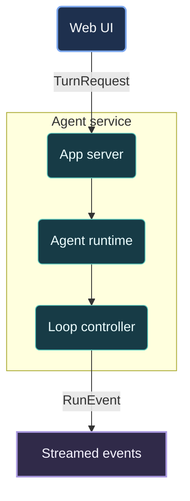
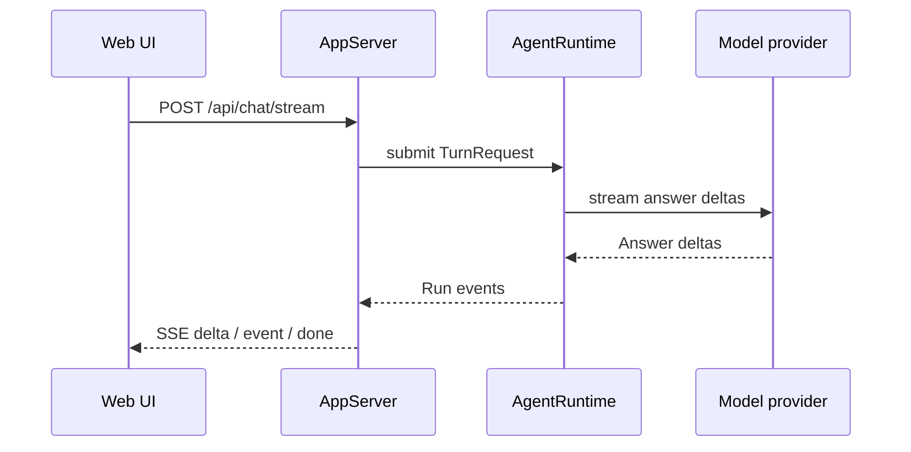

# Mermaid Diagrams

Create a visually composed explanation with clear hierarchy, readable labels, and meaningful color. Choose the format by the user's subject and desired interaction; do not force every request into Mermaid.

## Choose the output

| Request or subject | Preferred approach |
| --- | --- |
| A quick explanation, workflow, sequence, state machine, or data model in chat | Mermaid fenced block, using the guidance below. |
| AWS, Azure, GCP, Kubernetes, or on-prem infrastructure where recognizable service icons matter | Python **Diagrams** plus Graphviz; deliver a rendered image/vector and its Python source. |
| A polished architecture poster with nested groups and controlled layout | **D2**, rendered to SVG/PNG with editable `.d2` source. |
| A hand-drawn explanation or user-editable whiteboard | **Excalidraw**, retaining `.excalidraw` source and an image preview. |
| A system model with multiple architecture views and drill-down | **LikeC4**; use **Structurizr** if the project already maintains its model there. |
| An explorable explanation with filters, tooltips, or step-by-step animation | **HTML/SVG**; use **React Flow** when an existing React app needs draggable nodes and custom controls. |
| A diagram the user wants to edit in draw.io | Editable **draw.io** XML plus a rendered preview where supported. |
| Mathematical or geometric relationships | **Penrose** when available and appropriate; otherwise a precise SVG. |

Honor an explicit tool/format choice. For a cloud *call sequence* use a sequence diagram; choose Python Diagrams when the infrastructure topology and service icons are the point. For ordinary pan/zoom/inspection, Mermaid's built-in Explore view is sufficient; a request for interactivity does not automatically require a new app.

For a non-Mermaid route, read [references/diagram-tools.md](references/diagram-tools.md) for prerequisites, generation, and delivery. Check the tool is available, generate and inspect the output, and provide the finished artifact rather than merely suggesting software. If a dependency is missing, use permitted task-local setup or an available equivalent and explain any material fallback. Never present unrendered source as a completed visual.

## Mermaid in Kageha

Deliver a fenced `mermaid` block directly in Markdown so Kageha renders it in chat and Canvas.

Kageha supports inline drag to pan, zoom buttons, Ctrl/⌘ + scroll zoom, Fit, keyboard navigation, and an **Explore** view with SVG download. On touch devices, **Pan** enables diagram gestures; turn it off to scroll the page. These interactions come from the viewer; do not generate JavaScript callbacks, external embeds, or claim that nodes execute actions. Keep essential meaning visible without interaction.

For flowcharts, the component inspector can show purpose, related files, and incoming/outgoing relationships. Add optional plain-JSON comment annotations when supporting evidence is available:

```text
%% @node API {"description":"Validates the request and submits a turn.","files":["src/server.py:42"]}
```

The ID must match an actual flowchart node. Put each annotation on one line inside the Mermaid fence; use `description` and a `files` array of literal file/symbol references. These are inert details, not executable links or actions. Derive them from observed evidence, omit unavailable fields, and keep essential context in nearby prose. The viewer derives connections from the diagram itself; do not duplicate them in annotations.

## Workflow

1. Decide whether a diagram earns its space. Use one when there are at least three related nodes, a meaningful sequence, ownership hierarchy, branching decision, or state transition. Skip it for a single fact or a two-step instruction.
2. Choose the smallest useful diagram type:
   - `flowchart TD` for branching workflows and narrow chat columns; `flowchart LR` for short pipelines with at most four or five stages across.
   - `sequenceDiagram` for time-ordered calls, events, or provider interactions.
   - `graph TD` for ownership, dependency, or containment relationships.
   - `stateDiagram-v2` for lifecycle and phase transitions.
   - `erDiagram` only for real data relationships with cardinality.
3. Use observed evidence. Name real components, files, symbols, routes, event kinds, or providers. Do not invent arrows from naming similarity. Mark uncertain edges in nearby prose.
4. Compose for the reading surface: aim for 5–10 nodes in an overview and at most four or five nodes across. Prefer a vertical flow when a horizontal chain would become a ribbon. For a larger system, give an overview followed by focused detail diagrams; never omit important relationships just to meet a node count.
5. Make it render reliably. Use simple node IDs, quote labels containing punctuation, avoid raw HTML, and use Mermaid syntax supported by the web renderer.
6. Check for long labels, unnecessary crossings, and misleading relationships. When a browser preview is available, inspect the actual rendered result at a narrow width and in Explore; check that Fit includes every boundary and label. Open **Layout notes** if present: the viewer checks measured bounds, small overview text, overlapping components, and labels larger than their shapes, and adds outer space when needed. Shorten labels, simplify groups, or split the diagram when notes identify a readability issue; render again and inspect. Small text in a deliberately detailed overview may be acceptable when zoom works. These checks are heuristics, not proof of semantic correctness or a replacement for visual inspection. If a preview is unavailable, do not claim visual validation.
7. Explain the entry point, important boundary, and any inferred relationship in two or three sentences. Mention Explore briefly when detail benefits from zooming; do not repeat viewer instructions after every diagram.

## Visual quality rules

- Give the diagram a clear title in surrounding Markdown, not as a giant node.
- Use one or two labeled subgraphs when they clarify ownership or boundaries. Avoid deeply nested containers and decorative title nodes.
- Keep node text to a few words. Put explanations in prose or a separate detail diagram. For flowcharts, prefer quoted labels and rounded nodes for processes, cylinders for storage, and diamonds only for real decisions.
- Label edges with the contract crossing the boundary: `SSE`, `RunEvent`, `TurnRequest`, or `delta`.
- The viewer uses a dark navy canvas. Use a restrained blue/teal/violet palette with explicit light text when applying `classDef`; use amber for a meaningful warning or decision. Color should communicate roles, and labels/shapes should communicate those roles too.
- Prefer the app theme over per-diagram theme overrides. Avoid fixed SVG dimensions, font-size reductions, raw HTML labels, external icon dependencies, and security configuration changes. Shrinking text does not solve an overcrowded diagram.
- For codebase explanations, include file/symbol evidence in prose immediately below the diagram.
- Never expose secrets, tokens, internal prompts, or raw tool arguments in a diagram.

## Templates

### Architecture / data flow

Use this visual treatment as a starting point, adapting the structure and role classes to the real system. Keep the return path in a sequence diagram when showing it in a flowchart would create a long crossing edge.



### Execution sequence


